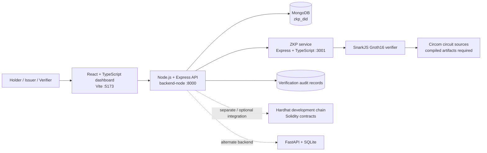

# Proofline project guide

**Project title:** Proofline: Privacy-Preserving Digital Identity Verification with Zero-Knowledge Proofs


## Purpose

Proofline explores how a holder can present evidence for an access policy without sending every credential claim to a verifier. The repository contains a web dashboard, API backends, a proof service, Circom circuit sources, and Solidity contracts. It is a prototype: production DID/VC signatures, secure holder storage, authenticated governance, and fully integrated on-chain writes are not complete.

## Architecture

The repository supports more than one local backend configuration. The active Node/Mongo configuration uses `backend-node/`; the original Python configuration uses FastAPI and SQLite. Select one API for a run because both use port 8000 by default.



The browser sends requests to the selected API. In Node/Mongo mode, the API stores DID, credential, governance, and audit records in MongoDB and calls the ZKP service during proof verification. Circuit source files alone do not provide a working prover: matching compiled circuit files and proving/verification keys are required. The local Hardhat contracts are a separate component; a database operation is not an on-chain transaction.

## Implemented modules

| Module | Current implementation |
| --- | --- |
| Dashboard | React/TypeScript screens for overview, credential issuance, holder records, proof verification, governance requests, and audit history. |
| Node API | Express/Mongoose endpoints for DID records, credential issue/list/revoke, policies, proof checks, audit history, and governance requests/votes. |
| MongoDB | Local persistence in database `zkp_did`; collections are created on first write. |
| Proof service | Separate Express/TypeScript service with SnarkJS integration and health endpoint. |
| Circuits | Circom circuit source files for identity/access predicates; compiled artifacts and trusted setup output are not committed. |
| Contracts | Solidity/Hardhat contract sources for registries, verification, governance, and audit concepts; local deployment is an optional separate workflow. |
| Alternate API | Python/FastAPI policy/API backend with SQLite. It is an alternative to `backend-node`, not a second API to run on the same port. |

## Main flows

### Credential issue

The issuer form posts issuer DID, holder DID, type, and claims to `POST /credentials/issue`. The Node API creates a W3C-shaped JSON credential record, hashes it with SHA-256, and stores it in MongoDB. This prototype does not cryptographically sign the credential, and claims are stored in the local database. The API reports `transaction_hash: null`; it does not claim an on-chain write.

### Proof verification

The verifier submits a proof, public signals, domain, credential hash, and nullifier to `POST /verify/proof`. The API rejects missing/revoked credentials, unknown domains, reused nullifiers, and proofs that do not verify. When verification succeeds, the current prototype permits only a policy with one predicate and public signal `1`; it denies policies whose predicates are not bound to the circuit. Both permit and deny decisions are recorded with a proof digest and reason. A denied result is a valid observed outcome, not a successful access grant.

### Governance

The API records data requests and accepts two distinct reviewer IDs before resolving a request. Reviewer identity is not authenticated or backed by on-chain voting in this demo. The form and API illustrate the workflow only.

## Run locally on Windows with Node.js and MongoDB

Use four VS Code terminals from the project root. If MongoDB already runs as a Windows service, skip its terminal. Keep each server running in its own terminal and do not start duplicate copies.

```powershell
# Terminal 1 (skip if MongoDB service is already running)
New-Item -ItemType Directory -Force .mongodb-data | Out-Null
mongod --dbpath .mongodb-data --bind_ip 127.0.0.1 --port 27017
```

```powershell
# Terminal 2: Node/Mongo API
cd backend-node
npm.cmd install
npm.cmd run dev
```

```powershell
# Terminal 3: proof service
cd zkp-service
npm.cmd install
npm.cmd run dev
```

```powershell
# Terminal 4: dashboard
cd frontend
npm.cmd install
npm.cmd run dev
```

Open `http://localhost:5173`. The Node API health endpoint is `http://localhost:8000/health`; the proof service health endpoint is `http://localhost:3001/health`. In MongoDB Compass, use `mongodb://127.0.0.1:27017`; `zkp_did` appears after the first database write. The local `.mongodb-data/` directory is ignored by Git.

## API routes in Node/Mongo mode

| Method | Route | Purpose |
| --- | --- | --- |
| GET | `/health` | API and MongoDB connection status |
| POST / GET | `/did/create`, `/did` | Create and list DID records |
| POST / GET | `/credentials/issue`, `/credentials` | Create and list credential records |
| POST | `/credentials/revoke` | Mark a credential revoked |
| GET | `/verify/policies`, `/verify/policy/:domain` | Read configured access policies |
| POST | `/verify/proof` | Verify proof and record decision |
| GET | `/verify/audit?limit=50` | Read recent verification history (maximum 100) |
| GET | `/verify/audit/:nullifier` | Read an audit record by nullifier |
| POST / GET | `/governance/request`, `/governance/requests` | Create and list governance requests |
| POST | `/governance/vote` | Record a demo reviewer vote |

The proof service exposes `GET /health`, `POST /prove`, and `POST /verify` among its routes. See [API reference](api-reference.md) for the broader service surface.

## Validation performed

On **29 October 2026**, read-only smoke checks against the running local services observed:

- `GET http://127.0.0.1:8000/health`: HTTP 200; API reported `healthy` and MongoDB `connected`.
- `GET http://127.0.0.1:3001/health`: HTTP 200; ZKP service reported `healthy`.
- `GET http://127.0.0.1:5173/`: HTTP 200; Vite served the dashboard page.
- Existing database observations: 2 credential records, 1 audit record (DENY), 0 governance requests, and 0 votes at the time checked. The audit denial reason stated circuit-specific predicate binding was required.

These are service/HTTP and existing-data observations, not an end-to-end proof acceptance, contract test, security audit, or passing automated test suite. Automated build and test suites were not run as part of this documentation update.

## Pending work and limitations

- Generate and version circuit-specific proving/verification artifacts, then bind every policy predicate to public inputs and test both accepted and rejected proofs.
- Add issuer authentication and verifiable cryptographic signatures, plus encrypted holder-controlled credential storage.
- Authenticate governance reviewers and prevent identity impersonation; use real quorum rules if moving beyond a demo.
- Integrate contract transactions/events with the API and document actual deployment evidence.
- Complete automated API/UI/contract tests, threat modeling, and independent circuit/contract reviews before production use.

Never use real personal data, development keys, or a public blockchain deployment with this prototype.
